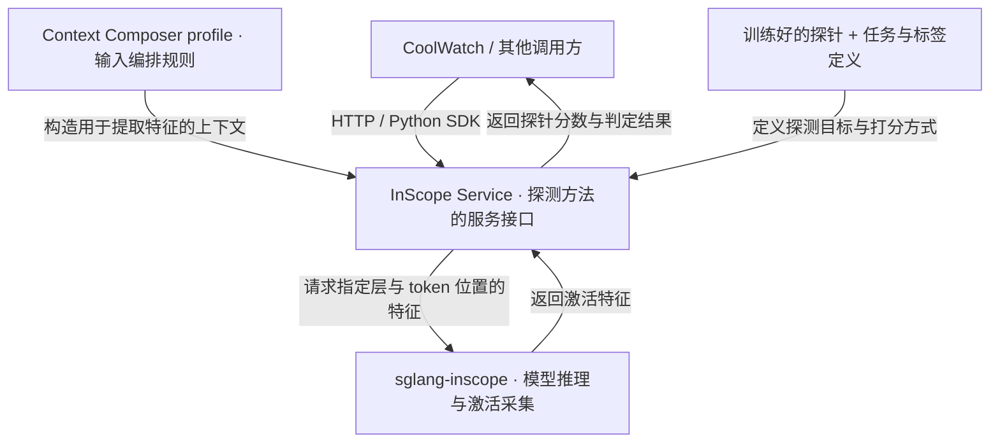

# InScope Service

**将基于模型内部特征的探测方法封装为服务接口。** 接收输入上下文，按配置采集模型激活，再交给训练好的探针计算分数并返回结果。

**服务负责“如何运行探测”，探针决定“探测什么”。** 探测目标、正负样本定义以及输出分数的业务含义，由探针的训练任务、标签定义和配套元信息决定。提示注入检测只是其中一种应用，不是 InScope Service 本身的固定定位。

本仓库提供 **HTTP 服务、Python SDK 和共享契约**，不负责训练探针，也不分发模型权重或探针 checkpoint。方法层的定位不等于当前实现已兼容任意模型、探针结构或输出类型；具体限制见下文。

## 架构与相关仓库



图使用 GitHub Markdown 支持的 Mermaid 渲染。节点附带仓库链接；若阅读器禁用图中点击或不支持 Mermaid，可直接使用以下链接：

| 仓库 | 职责 |
| --- | --- |
| [CoolWatch](<https://github.com/RebeccaZhang22/CoolWatch>) | 业务平台，消费探测结果；不是使用本服务的必要依赖 |
| [InScope Service](<https://github.com/yeasen-z/inscope-service>) | 上下文编排、探针加载、特征请求、打分与服务接口 |
| [sglang-inscope](<https://github.com/yeasen-z/sglang-inscope>) | 底层推理驱动，运行模型并提供激活采集接口，需单独部署 |

单次探测流程：**输入上下文 → Composer 编排 → 引擎提取特征 → 探针打分 → 返回结果**。业务调用方根据该探针的任务与标签定义解释结果，而不是由服务名称推断含义。

## 快速开始

### 1. 安装

需要 Python **3.11 或以上**。以下从本仓库安装，不依赖 PyPI 是否已发布对应版本：

```bash
git clone https://github.com/yeasen-z/inscope-service.git
cd inscope-service

# 部署检测服务
python -m pip install ".[server]"

# 若只在调用方使用 SDK，改用：
# python -m pip install .
```

仅客户端安装不会引入 torch、transformers、FastAPI 或 uvicorn。

### 2. 准备模型、引擎和探针

启动前需要准备：

1. **模型与 tokenizer**：当前服务校验的是 Qwen3-8B-FP8，需提供本地权重目录。
2. **sglang-inscope 引擎**：与服务使用相同模型，启动时启用 `SGLANG_ENABLE_FEATURE_CAPTURE=1`；普通 SGLang 不保证支持特征接口。
3. **可信的探针 checkpoint**：当前已验证 `fyh.probe_checkpoint.v2` 线性探针；如有配套 `manifest.json`，放在权重同目录。
4. **匹配的 Composer profile**：必须与探针训练时的上下文处理规则一致，不能仅凭名称或位置数选择。

服务不会自动启动引擎。下面假定引擎已监听 `http://127.0.0.1:31100`。

### 3. 配置并启动

替换下列路径、口令和 profile ID：

```bash
export INSCOPE_MODEL_PATH='/path/to/Qwen3-8B-FP8'
export INSCOPE_PROBE_CHECKPOINT='/path/to/probe/best.pt'
export INSCOPE_COMPOSER_PROFILE='replace-with-matching-profile-id'
export INSCOPE_API_KEY='replace-with-a-strong-secret'
export INSCOPE_ENGINE_URL='http://127.0.0.1:31100'

# 检查 checkpoint 与 profile，不启动 HTTP 服务，也不访问引擎
inscope-serve --preflight-only

# 启动服务；仅需本机访问时保持此监听地址
inscope-serve --host 127.0.0.1 --port 8302
```

可用 profile 及绑定条件见 [profile 注册表](<inscope_server/context_profile.py>)。启动自检成功不代表模型、引擎或整个检测链路已就绪；还需调用下面的就绪接口。

### 4. 验证就绪并检测

```bash
curl --fail-with-body http://127.0.0.1:8302/health/ready \
  -H "Authorization: Bearer ${INSCOPE_API_KEY}"

curl --fail-with-body http://127.0.0.1:8302/detect \
  -H "Authorization: Bearer ${INSCOPE_API_KEY}" \
  -H 'Content-Type: application/json' \
  -d '{"messages":[{"role":"user","content":"Please summarize this report."}]}'
```

`/health/ready` 会实际执行一次特征采集与探针打分，不只是检查端口。

## Python SDK

### 同步调用

```python
import os
from inscope import Client

client = Client("http://127.0.0.1:8302", api_key=os.environ["INSCOPE_API_KEY"])
result = client.detect([
    {"role": "user", "content": "Please summarize this report."}
])
print(result.label, result.probability, result.threshold)
```

### 异步调用

```python
import asyncio
import os
from inscope.client import AsyncClient

async def main():
    async with AsyncClient(
        "http://127.0.0.1:8302", api_key=os.environ["INSCOPE_API_KEY"]
    ) as client:
        result = await client.detect([
            {"role": "user", "content": "Please summarize this report."}
        ])
        print(result.label, result.probability)

asyncio.run(main())
```

两种客户端均提供 `detect(messages, tools=None, request_id=None)`、`info()` 和 `ready()`。

## HTTP 接口

除存活检查外，接口均要求 `Authorization: Bearer <INSCOPE_API_KEY>`。

| 方法 | 路径 | 用途 |
| --- | --- | --- |
| GET | `/health/live` | 进程存活检查，不验证模型或引擎 |
| GET | `/health/ready` | 实际运行检测链路，确认服务就绪 |
| GET | `/info` | 查询当前探针、层号、位置、阈值和 Composer 配置 |
| POST | `/detect` | 检测对话；请求包含 `messages`，可选 `tools` |

检测结果的主要字段：

| 字段 | 含义 |
| --- | --- |
| `logit` | 探针输出的原始分数 |
| `probability` | 当前二分类实现中的 `sigmoid(logit)`；正类含义由探针的训练标签定义，不保证经过概率校准 |
| `threshold` | checkpoint 提供的判定阈值，在 probability 空间比较 |
| `label` | `probability >= threshold` 时为 `attack`，否则为 `benign` |
| `input_tokens` | Composer 实际输出的 token 数 |
| `composer_profile` / `composer` | 使用的 profile ID 与编排配置 |
| `checkpoint_sha256` | 权重文件摘要，用于追踪具体文件 |
| `request_id` / `latency_ms` | 请求标识与服务端处理耗时 |

**当前接口仍有提示注入场景的历史命名**：`label` 使用 `attack` / `benign`，`risk` 固定为 `indirect_prompt_injection`。这些字段目前没有随探针任务动态变化，不能据此宣称服务已支持任意任务语义。接入其他任务时，需要同时适配输出标签与任务元信息；仅替换权重不会自动完成这一步。

常见错误：`401` 鉴权失败、`413` 输入超限、`422` 输入不合法、`429` 并发已满、`503` 特征后端或打分异常、`504` 超时。超长输入会被拒绝，不会静默截断。

## 配置参考

| 环境变量 | 必填 / 默认值 | 说明 |
| --- | --- | --- |
| `INSCOPE_MODEL_PATH` | 必填 | 本地模型与 tokenizer 目录 |
| `INSCOPE_PROBE_CHECKPOINT` | 必填 | 探针权重文件路径 |
| `INSCOPE_COMPOSER_PROFILE` | 必填 | 已注册且与探针匹配的 profile ID |
| `INSCOPE_API_KEY` | 必填 | 调用本服务的鉴权口令 |
| `INSCOPE_ENGINE_URL` | `http://127.0.0.1:30000` | sglang-inscope 引擎地址 |
| `SGLANG_API_KEY` | 空 | 引擎启用鉴权时使用，与本服务口令不同 |
| `INSCOPE_MAX_INPUT_TOKENS` | `40959` | 输入 token 上限，可调小 |
| `INSCOPE_MAX_INFLIGHT` | `16` | 检测及就绪检查的并发上限 |
| `INSCOPE_REQUEST_TIMEOUT` | `60` | 请求超时，单位秒 |

HTTP 监听地址与端口可用 `--host` / `--port` 指定。不传时默认为 `0.0.0.0:8302`；对外部署时应限制访问并在代理层配置 TLS。

## 更换探针与上下文规则

**先确认探针在训练时学的是哪个目标，再对齐特征提取与输入编排规则。** 权重本身不一定包含完整的任务说明，交付探针时还应附带训练目标、标签定义、阈值含义和验证记录。

- **探测任务**：由训练目标与标签定义决定；服务执行探针，不替探针定义业务含义。
- **Checkpoint / manifest**：提供层号、token 位置、归一化参数、输入维度和阈值。manifest 声明 SHA-256 时，服务会校验权重文件。
- **Composer profile**：控制对话选窗、CoT 处理、模板渲染和探测前缀。服务会检查 profile 与探针的 `probe_id` 绑定，以及位置配置的一致性。
- **身份与文件分开**：未显式声明 `probe_id` 时，服务从架构、数据集名和 `feature_name` 派生。同一组元信息可对应不同权重；具体文件应以 `checkpoint_sha256` 区分。

更换步骤：准备权重及配套元信息 → 选择或实现匹配的 profile → 修改环境变量 → 运行自检 → 重启并验证就绪及代表性样本。

**不能承诺任意 checkpoint 换文件即可运行。** 当前实现以 Qwen3-8B-FP8、hidden size 4096、标准归一化和 `[batch, layer, token, hidden]` 铺平顺序为基础，已验证的是 v2 线性探针。新架构、新编排策略需要实现与验证；保留的 `a5_simplified_v1` profile 不代表已支持 A5 blend 权重加载。

层号也必须显式对齐：SGLang 使用 residual-stream **边界号**。若 checkpoint 声明的是零起始 decoder block 输出，`block b` 对应 `boundary b + 1`；若已声明边界号则不转换。优先采用 manifest 的 `inscope_layers`，没有可用语义时拒绝加载。详见 [层号契约](<inscope_contract/layers.py>)。

> 仅加载可信来源的 checkpoint；当前加载器使用 PyTorch pickle 反序列化。上下文规则应以训练配置为依据，不应通过调整前缀来迎合几条测试样本的分数。

## 开发与验证

在仓库根目录执行：

```bash
python -m pip install -e ".[server,dev]"
python -m pytest -q
```

代码分为三个包：`inscope_contract`（共享契约）、`inscope_server`（服务端）、`inscope`（客户端）。服务端和客户端各自依赖 contract，互不导入；[架构测试](<tests/test_architecture.py>)检查该约束。

现有单元测试无需 GPU；真实端到端验证另需模型、探针与引擎。少量样本跑通不等于检出率、误报率或训练侧数值一致性已验证。具体实验、部署记录及待办见 [交接文档](<HANDOFF.md>)。

## License

见 [LICENSE](<LICENSE>)。
