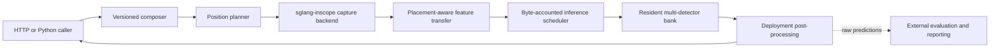

# Modular detection pipeline

The existing v2/v3 message API remains unchanged. The new opt-in pipeline mode
serves the all-position Transformer checkpoints used by the current detector
study. It lives in `inscope_server/detection/`; it does not import the training
repository. Evaluation remains in the calling application.



## Stage contracts

- `composer.py`: compile once, preserve token IDs, context/tools policy and
  declared observation/anchor boundaries. `CompiledComposer` is the initial
  adapter for already compiled, training-aligned contexts. It validates an
  explicit composer ID and never substitutes legacy A6/v3 message composition.
  Natural-message composers implement the `Composer` protocol only after their
  token IDs and boundaries have been accepted against training fixtures.
- `planner.py`: derive the full observation grid from boundaries, add post/suffix
  anchors and position0 for full prefill; merge detector layer demand. No labels,
  injection spans or inspection budget affect selected positions.
- `native_backend.py`: multiplex requests by ID over the native binary capture
  bridge. Validate model/layer/position identity, preserve BF16 bits, enforce
  per-endpoint 3M/5M prompt-token admission and4096 client requests, and cancel
  abandoned work. Native MRR64 is an engine setting, not client concurrency.
- `token_probe.py`: load pinned checkpoint hashes and strict architecture
  contracts, share captured layers across detectors, retain separate weights,
  normalization and thresholds. Multiple detectors may use the same layer.
  This implementation supports the current all-linear width256 H8 depth1 family
  (and compatible explicit widths/depths); legacy v2/v3 runtimes remain available
  through the existing API. Unsupported architectures fail explicitly.
- `scheduler.py`: bounded position/byte microbatches, one GPU execution worker,
  request cancellation and original-result routing. A long DP can run alone
  above the batch target, within an explicit per-request limit; no truncation.
- `postprocess.py`: independent per-detector frozen-threshold decisions and
  optional contiguous token ranges. The pre position is excluded from ranges.
  `output: scores` omits token arrays for cheap serving responses;
  `enabled_detectors` filters named outputs (the resident bank currently executes
  the complete compatible bank). Whole-sentence expansion can be a separate
  deployment policy with a validated token-to-text mapping.
- `pipeline.py`, `app.py`: wire stages together, reserve memory before capture,
  authentication, bounded HTTP body/concurrency/deadline, readiness and stage
  timings. Readiness warms inference kernels and verifies native endpoints;
  use a real `/detect` canary to check complete feature capture.

No coverage, recall, F1, candidate-cost, label loading, threshold fitting or
completion audit is implemented here. These belong to the external evaluation
runner. `/status` reports operational queue/latency/resource counters only.

## Placement and ownership

`gpu_transport.py` reuses sglang-inscope's stream-ordered CUDA IPC pool rather
than inventing independent allocator/event machinery:

| Placement | Feature payload path | Lifetime |
|---|---|---|
| Same GPU, different processes | Borrow a shared GPU slice | Release after the inference worker finishes reading |
| Different GPUs on one host | CUDA IPC mapping + device copy over P2P/NVLink | Source lease acknowledged after device copy; local copy owned by detector |
| Host compatibility | Original bounded BF16 binary frames | Host byte reservation and normal inference staging |

The descriptors contain only schema-checked local capability metadata, not
pickled Python code. Match physical GPU UUIDs, not process-local CUDA ordinals.
Ready/generation/ack words prevent a producer from overwriting a live slice.
The scheduler retains borrowed leases even when the HTTP caller times out, until
in-flight GPU work completes. Abandoned replies are acknowledged without copying
full features. Close detector mappings before shutting down their producers.

A disconnected/crashed consumer must never cause a source slice to be recycled
on a timer while it could still be reading. Pool capacity and byte admission
bound the retained memory; inspect reservations and recover the owned worker
session explicitly if a consumer process dies. A full GPU pool fails clearly by
default. Host fallback is explicit; never silently weaken precision or drop rows.

## Native device-output hook

`sglang-inscope` must have `OUTPUT_FACTORY_API_VERSION=1` in
`sglang.srt.feature_capture.recorder`. The small runtime change adds an opt-in
`SGLANG_FEATURE_OUTPUT_FACTORY=module:function` seam to
`FeatureDeviceOutput.copy_to_host`; the default path still calls the original
D2H implementation. The service supplies
`inscope_server.detection.sglang_ipc_output:copy_to_ipc`.

The hook handles chunked prefills by accumulating per-request device descriptors
until every requested position is captured. It adds no layer hooks, changes no
model weights and performs no metric calculation. GPU pool admission uses actual
feature bytes in addition to prompt-token admission. Byte limits must leave room
for model KV/state, attention workspace and detector normalization, especially
when co-located. `max_capture_bytes` is reduced against measured GPU headroom
when `transport: cuda_ipc` is selected.

`python -m inscope_server.detection.sglang_worker` is an optional dedicated bridge
launcher. Its engine JSON contains the normal Engine settings plus
`inscope_hidden_dim`; model/scheduler knobs remain explicit deployment artifacts.
The worker never stops another GPU owner. It reserves output bytes until a
consumer release message and uses a bounded source pool. The local ZMQ socket is
an internal trusted endpoint, not a public API.

## Launch

Install the server and native extras against the pinned local sglang-inscope
fork. Do not replace that fork with an unrelated PyPI SGLang build.

```bash
python -m pip install '.[server,native]'
PYTHONPATH=. python tools/import_token_probe_plan.py \
  --plan /path/to/frozen/plan.json \
  --calibration /path/to/existing/detector-best-f1.json \
  --composer-id super-simplified-v1 \
  --endpoint ipc:///path/to/capture.sock --output /path/to/pipeline.json
# Default host budget = measured available RAM minus256GiB; explicit override
# is available for other machines. No historical256-DP/32GiB queue cap.
INSCOPE_API_KEY=... python -m inscope_server.cli \
  --pipeline-config /path/to/pipeline.json --preflight-only
INSCOPE_API_KEY=... python -m inscope_server.cli \
  --pipeline-config /path/to/pipeline.json --host 127.0.0.1 --port 8303
```

For a GPU-output bridge, set `transport: cuda_ipc` and its endpoint in the pipeline
config. Choose `CUDA_VISIBLE_DEVICES`/`--device` for the detector placement. GPU
UUID negotiation works when each process sees a different local device ordinal.
Engine pool size and detector byte/position budgets are explicit, independent
limits. No dataset or label is required to run the service.

`tools/run_pipeline.py start/status/stop --runtime ...` manages only its owned API
PID, keeps a mode0600 local key, and leaves feature engines untouched.

`POST /detect` in this opt-in mode accepts `CompiledDetectionRequest`: composer
ID, original input IDs, pre/tail/post/suffix boundaries, optional named detector
filter and `output: tokens|scores`. Ordinary messages remain supported by the
existing legacy mode; they are not accepted as equivalent compiled inputs here.

## Validation boundaries

`tools/benchmark_gpu_transfer.py` exercises bounded cross-process same-GPU and
P2P transfers, full payload equality and lease recycling. It separates cold IPC
mapping from warm measurements. `tools/accept_gpu_detector.py` exercises the real
native device-output seam and ten frozen detector heads without loading a new
LLM. Those are transport/runtime acceptance tests, not detection metrics.

Real-Qwen HTTP/native captures, long contexts, chunked prefill, interruption and
sustained concurrency still require deployment-specific canaries and load tests.
Do not infer complete end-to-end throughput from a synthetic transfer speedup,
or call shared-hardware timings exclusive production capacity.


Feature payloads are transient. Same-GPU consumers borrow a generation-safe
pool lease through the end of detector GPU reads; peer consumers acknowledge
source storage after the stream-ordered copy and retain destination storage
through inference. Cancellation waits for outstanding copies/reads before
release. Allocators retain capacity for reuse, so released features need not
cause `nvidia-smi` memory usage to fall. Feature persistence/cache is not enabled.

The receiver activates its CUDA Driver context on every transfer worker, including
cached IPC imports. The explicit host-relay baseline moves D2H and frame creation
off the control loop, retains bounded frames and waits for in-flight reads before
closing a cancelled generator. `tools/accept_capture_cancellation.py` tests real
capture cancellation/recovery. `tools/accept_pipeline_placements.py` compares
actual token/DP logits and threshold decisions across the three HTTP placements;
it loads compiled inputs, never evaluation labels. Run the host baseline only
for comparison, and stop its API afterwards.

## Dense asymmetric convolution locator

Set `bank.kind` to `asymmetric_conv` and set `bank.layers` to the ordered
capture layer IDs. Each bank checkpoint entry supplies `layer`, `checkpoint`,
`checkpoint_sha256`, and `training_config` (the frozen training YAML path).
The YAML and its normalization statistics must match the hashes recorded in
the training artifacts. A checkpoint entry may supply `statistics` to locate the
same hashed file after moving the bundle. The service accepts stride-1, uncentered convolution
locators with a body-max inference pool, including anchored and residual
variants. Use the same backbone and compiled prompt policy as in training.

Use `logit_threshold` for the DP flag and `token_logit_threshold` for spans in
each detector entry. For example, the L16 ±4 / P64 / C32 seed-42 serial-grid
baseline has a validation best-F1 DP threshold of `6.5625` and a dense IoU
token threshold of `3.203125`. Its DP logit equals its region logit.
The response reports `detector_logit: null` for this observation-only bank.
